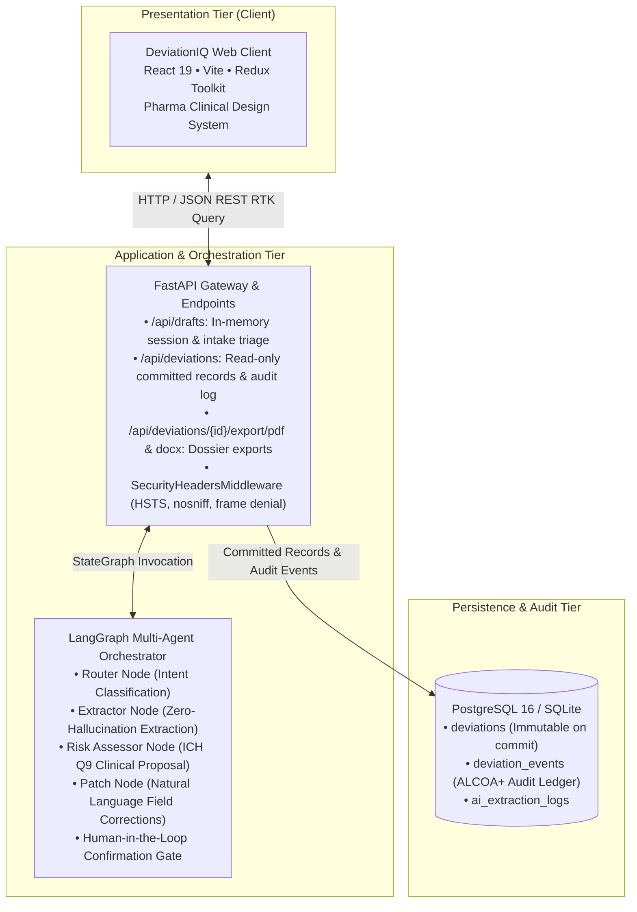

# DeviationIQ — AI-Powered Deviation Intake Module

[](https://www.python.org/downloads/)
[](https://react.dev/)
[](https://fastapi.tiangolo.com/)
[](https://langchain-ai.github.io/langgraph/)
[](https://www.fda.gov/)
[](LICENSE)
[](backend/tests/)

An enterprise, pharmaceutical-grade Deviation Intake Module engineered in strict compliance with **FDA 21 CFR Part 11**, **ICH Q9/Q10**, and **GAMP 5** standards. The system accelerates deviation intake and incident triage while enforcing human-in-the-loop oversight, zero-hallucination guardrails, and immutable audit trails.

---

## 🏛️ Architecture Overview

The system implements a decoupled, three-tier contract-first architecture powered by an asynchronous LangGraph state machine:



---

## ✨ Key Features & Regulatory Compliance

1. **Human-in-the-Loop Confirmation Gate (21 CFR Part 11 / SAD §4)**:
   - The AI risk assessor generates severity and impact proposals with clinical justification.
   - The system structurally **blocks** final deviation commitment until an authorized quality officer reviews, confirms, or modifies the assessment.

2. **Append-Only Immutable Audit Trail (ALCOA+ / FRD §3)**:
   - All state modifications are stored in the immutable `deviation_events` ledger with actor attribution (`ai` vs `human`), before/after diffs, confidence scores, and verbatim source snippets.
   - Once committed, deviations become **strictly read-only** at the API level (HTTP 409 Conflict on mutation attempts).

3. **Field-Level Confidence & AI Provenance (UIUX §3)**:
   - Visual highlighting of fields (`high`, `medium`, `low`) with expandable source snippet quotes.
   - Human manual overrides and natural language corrections cleanly transition field ownership from `ai` to `human`.

4. **Multi-Modal Document Ingestion**:
   - Supports raw text pasting and multi-format document uploads (PDF, DOCX, TXT) processed through the same validated extraction pipeline.

5. **Anti-Hallucination & Prompt Injection Defense (Security Plan §3)**:
   - System prompts enforce strict separation: user documents are treated purely as **untrusted data**, never executable instructions.
   - Null extraction constraint (FR-07): If information is not clearly present in the source text, the model returns `null` rather than fabricating values.

6. **Publication-Grade GxP Dossier Exports**:
   - Automated server-side generation of high-precision GxP **PDF** and **DOCX** deviation dossiers complete with running headers, electronic signature blocks, and audit trail diffs.

---

## 📑 Documentation & Regulatory Reports

All system specifications and publication-grade reports are organized under the [`docs/`](docs/README.md) directory:

- 📊 **[Comprehensive Technical Project Report (PDF)](docs/reports/DeviationIQ_Technical_Report.pdf)**: 38-page publication-grade specification with vector Mermaid architecture diagrams, ER diagrams, data contracts, and verification matrices.
- 🎙️ **[Pipeline Explainer Guide (PDF)](docs/reports/Pipeline_Explainer.pdf)**: 9-page two-way guide covering technical pointwise breakdowns and executive conversational pitch scripts.
- 🏛️ **[Architectural & GxP Specification Suite](docs/architecture/)**: Complete 17-document specification package (BRD, PRD, SRS, SAD, Database ER, Security Plan, Test Plan, and QAP).

---

## 🚀 Quick Start (Development Mode)

To launch the development stack (PostgreSQL + FastAPI + React with hot-reloading):

```bash
# 1. Clone repository
git clone https://github.com/BEAST-AMMAR/Deviation-QMS-IQ.git
cd Deviation-QMS-IQ

# 2. Configure environment variables (fill in your GROQ_API_KEY)
cp .env.example .env

# 3. Launch development containers
docker compose up --build
```

- **Frontend Application**: `http://localhost:5173`
- **Backend API & Swagger Docs**: `http://localhost:8000/docs`
- **PostgreSQL Database**: `localhost:5432` (db: `deviationiq`, user: `postgres`)

---

## 🏭 Production Enterprise Deployment

The production stack deploys a multi-stage Nginx container serving optimized React static assets with reverse-proxy routing to a hardened, non-root FastAPI application:

```bash
# 1. Configure production environment
cp .env.example .env
# Set secure passwords and valid GROQ_API_KEY in .env

# 2. Launch production stack
docker compose -f docker-compose.prod.yml up -d --build
```

- **App Gateway & Web Interface**: `http://localhost:80`
- **API Swagger Documentation**: `http://localhost:8000/docs`
- **Health Check Endpoint**: `http://localhost:80/health`

---

## 💻 Local Development Setup (Without Docker)

### Backend Setup

```bash
cd backend

# 1. Create and activate virtual environment
python -m venv .venv
# Windows:
.venv\Scripts\activate
# Linux/macOS:
source .venv/bin/activate

# 2. Install dependencies
pip install -r requirements.txt

# 3. Start backend server
uvicorn app.main:app --reload --port 8000
```

### Frontend Setup

```bash
cd frontend

# 1. Install dependencies
npm install

# 2. Run development server
npm run dev

# 3. Build production bundle
npm run build
```

---

## 🧪 Testing & Quality Assurance

### Run Backend Unit & Integration Tests (40 passing tests)

```bash
cd backend
python -m pytest tests -v
```

### Run AI Evaluation Harness (Test Plan §3)

The offline evaluation harness benchmarks field extraction accuracy, null-correctness, and prompt injection defense against 6 synthetic GxP incident fixtures:

```bash
cd backend
python -m app.eval.run_eval
```

- **Extraction Accuracy**: 31 / 35 fields (89% fuzzy match across formal incident emails, shift notes, calibration logs, and terse technician reports).
- **Null-Correctness (Anti-Hallucination)**: 7 / 7 (100% correct null returns when fields are unstated).
- **Prompt Injection Defense**: 100% isolated and neutralized.

---

## 📁 Repository Structure

```
Deviation-QMS-IQ/
├── .github/                             # CI/CD Workflows & Repository Governance
│   ├── workflows/ci.yml                 # Automated Pytest & Vite Build Actions
│   ├── ISSUE_TEMPLATE/                  # Bug report & feature request templates
│   └── pull_request_template.md         # GxP & 21 CFR Part 11 PR checklist
├── .env.example                         # Environment configuration template
├── .gitignore                           # Comprehensive Git exclusions
├── docker-compose.yml                   # Development orchestration (hot-reload)
├── docker-compose.prod.yml              # Production orchestration (Nginx + non-root API)
├── LICENSE                              # Apache 2.0 License
├── README.md                            # Project overview & quickstart (this file)
├── SECURITY.md                          # Vulnerability reporting & GxP disclosures
├── CONTRIBUTING.md                      # Development & review guidelines
│
├── docs/                                # Enterprise Documentation Suite
│   ├── README.md                        # Master documentation index & reading guide
│   ├── reports/                         # Publication-grade technical & executive dossiers
│   │   ├── DeviationIQ_Technical_Report.pdf # 38-page technical project report
│   │   └── Pipeline_Explainer.pdf       # 9-page two-way engineering & pitch guide
│   └── architecture/                    # Formal GxP Specifications (01_BRD to 17_Demo)
│
├── backend/                             # Python 3.11+ FastAPI + LangGraph Service
│   ├── app/
│   │   ├── config.py                    # Pydantic BaseSettings
│   │   ├── database.py                  # SQLAlchemy 2.0 Async Engine (Postgres / SQLite)
│   │   ├── models.py                    # ORM Models (Deviation, Events, AI Logs)
│   │   ├── schemas.py                   # Pydantic v2 schemas (Single source of truth)
│   │   ├── reports.py                   # PDF & DOCX regulatory export generator
│   │   ├── graph/                       # LangGraph StateGraph, Nodes & Prompts
│   │   ├── routers/                     # /api/drafts & /api/deviations endpoints
│   │   ├── services/                    # Audit logger & document parser
│   │   └── eval/                        # AI evaluation harness & fixtures
│   ├── tests/                           # Pytest suite (30 unit & integration tests)
│   ├── requirements.txt
│   ├── Dockerfile                       # Development Dockerfile
│   └── Dockerfile.prod                  # Production hardened Dockerfile (non-root)
│
└── frontend/                            # React 19 + Redux Toolkit + Vite Web App
    ├── src/
    │   ├── components/                  # FormPanel, CopilotPanel, ConfirmationCard, Drawers
    │   ├── store/                       # Redux store, apiSlice, draftSlice, chatSlice
    │   ├── index.css                    # Pharmaceutical-grade design system
    │   ├── App.jsx
    │   └── main.jsx
    ├── package.json
    ├── vite.config.js
    ├── nginx.conf                       # Production Nginx reverse-proxy & security config
    ├── Dockerfile                       # Development Dockerfile
    └── Dockerfile.prod                  # Multi-stage production Nginx Dockerfile
```

---

## ⚖️ License & Compliance Notice

This project is licensed under the **Apache License 2.0**. See the [LICENSE](LICENSE) file for complete details.

*Disclaimer: This software is designed as a deviation intake accelerator and decision-support module. In accordance with FDA 21 CFR Part 11 and EU Annex 11, final regulatory decisions and deviation classifications remain under human quality assurance authority.*
