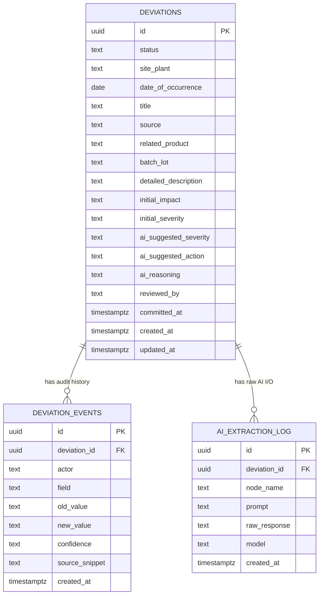

# Database Schema & Entity-Relationship Document
## AI-Powered Deviation Intake Module

### 1. Purpose of this document
The exact, buildable data contract — the single source of truth for table shapes. The TDD
references these tables; it does not redefine them, to avoid two documents disagreeing
about a column name.

### 2. Entity-relationship diagram


### 3. DDL (PostgreSQL)
```sql
CREATE EXTENSION IF NOT EXISTS "uuid-ossp";

CREATE TABLE deviations (
    id UUID PRIMARY KEY DEFAULT uuid_generate_v4(),
    status TEXT NOT NULL CHECK (status IN ('draft','committed')) DEFAULT 'draft',
    site_plant TEXT,
    date_of_occurrence DATE,
    title TEXT,
    source TEXT,
    related_product TEXT,
    batch_lot TEXT,
    detailed_description TEXT,
    initial_impact TEXT,
    initial_severity TEXT,
    ai_suggested_severity TEXT,
    ai_suggested_action TEXT,
    ai_reasoning TEXT,
    reviewed_by TEXT,
    committed_at TIMESTAMPTZ,
    created_at TIMESTAMPTZ NOT NULL DEFAULT now(),
    updated_at TIMESTAMPTZ NOT NULL DEFAULT now()
);

CREATE TABLE deviation_events (
    id UUID PRIMARY KEY DEFAULT uuid_generate_v4(),
    deviation_id UUID NOT NULL REFERENCES deviations(id) ON DELETE CASCADE,
    actor TEXT NOT NULL CHECK (actor IN ('ai','human')),
    field TEXT NOT NULL,
    old_value TEXT,
    new_value TEXT,
    confidence TEXT,
    source_snippet TEXT,
    created_at TIMESTAMPTZ NOT NULL DEFAULT now()
);
-- Append-only by convention: no UPDATE/DELETE route is exposed on this table (see
-- 14_Security_Plan.md, control SC-06).

CREATE TABLE ai_extraction_log (
    id UUID PRIMARY KEY DEFAULT uuid_generate_v4(),
    deviation_id UUID REFERENCES deviations(id) ON DELETE CASCADE,
    node_name TEXT NOT NULL,
    prompt TEXT,
    raw_response TEXT,
    model TEXT,
    created_at TIMESTAMPTZ NOT NULL DEFAULT now()
);

CREATE INDEX idx_deviation_events_deviation_id ON deviation_events(deviation_id);
CREATE INDEX idx_ai_extraction_log_deviation_id ON ai_extraction_log(deviation_id);
```

LangGraph's `PostgresSaver` checkpointer manages its own internal tables
(`checkpoints`, `checkpoint_writes`, etc.) automatically via its setup routine — these are
not hand-defined here; they're created by calling the checkpointer's built-in migration on
first run.

### 4. Design notes
- `deviations` holds **current state only** — fast to query, simple for the frontend to
  render directly.
- `deviation_events` is **append-only** and is the ALCOA+ audit trail — see `07_SAD` §4 for
  why this exists as a separate table rather than versioned columns.
- `ai_extraction_log` stores raw model I/O for debugging and for the offline evaluation
  harness described in `15_Test_Plan.md` §3 — it is not shown to end users.
