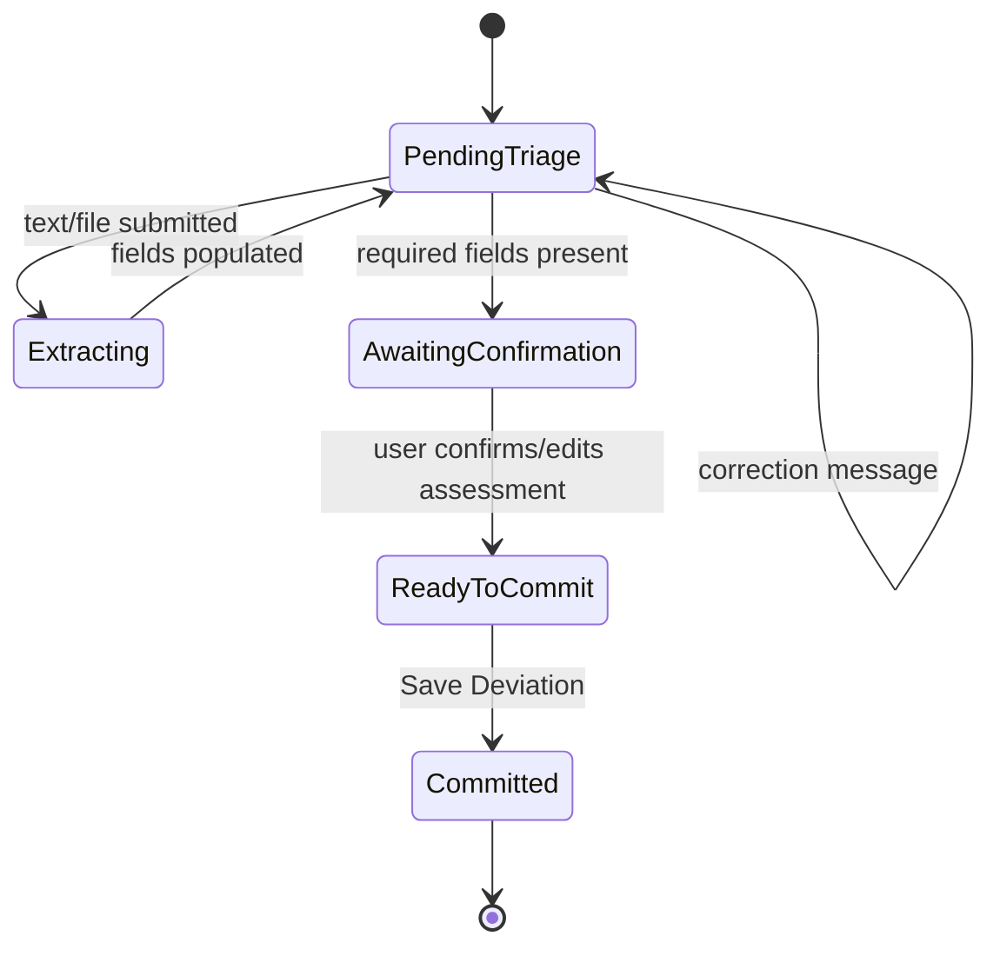

# UI/UX Wireframes & Design
## AI-Powered Deviation Intake Module

### 1. Purpose of this document
Text-based wireframes and state descriptions precise enough to build from directly,
following the assessment's reference screenshot and the reference demo video's confirmed
interaction pattern (extraction → highlight → risk assessment → correction → commit).

### 2. Layout — primary screen (two-panel, matches reference screenshot)
```
┌───────────────────────────────────────────┬───────────────────────────────┐
│ Log Deviation                    [Status●] │  AI Deviation Assistant [BETA] │
│ Record any unexpected event...             │  Drag & drop or paste text      │
├─────────────────────────────────────────── │─────────────────────────────── │
│ 1. DEVIATION INFORMATION                   │  ┌───────────────────────────┐ │
│  Site/Plant*        Date of Occurrence*    │  │  Drop zone / paste box     │ │
│  [__________]        [__/__/____]          │  └───────────────────────────┘ │
│  Title*              Source*               │  Extraction progress: ▓▓▓░░ 60%│
│  [__________]        [ dropdown ▾]         │─────────────────────────────── │
│  Related Product      Batch/Lot Number     │  Chat thread (scrollable)       │
│  [__________]        [__________]          │   ● system: "Ready..."         │
├─────────────────────────────────────────── │   ● user: <pasted text>        │
│ 2. DEVIATION DETAILS                       │   ✓ assistant: "Extracted..."  │
│  Detailed Description*      (0/2000)       │   ⚠ assistant (confirm card):  │
│  [multi-line textarea]                     │     Severity: Major             │
│  Initial Impact*    Initial Severity*      │     Reasoning: "..."            │
│  [dropdown ▾]        [dropdown ▾]          │     [Confirm] [Edit]            │
├─────────────────────────────────────────── │─────────────────────────────── │
│ [Reset Form]              [Save Deviation] │  [📎] [ Ask/paste... ] [Send]   │
└───────────────────────────────────────────┴───────────────────────────────┘
```

### 3. Field highlight states
| State | Visual treatment | Meaning |
|---|---|---|
| Empty | Grey placeholder text ("Awaiting AI extraction...") | Not yet populated |
| AI-filled, high confidence | Light blue background/border | AI-origin, unconfirmed |
| AI-filled, low/medium confidence | Amber border + info icon (tooltip = source snippet) | Needs human attention |
| Human-confirmed/edited | White background, normal border | Reviewed, trusted |
| Committed (read-only) | Greyed-out, disabled inputs | Locked per `07_SAD` §4 |

### 4. Status badge states
`Pending Triage` (grey/yellow, no fields yet) → `Extracting...` (blue, in progress) →
`Ready to Commit` (green, required fields present + assessment confirmed) →
`Committed` (dark green, locked).

### 5. Confirmation card (the interrupt UI — new, not in the reference video's Complaints
demo but required here per `07_SAD` §4)
```
┌─────────────────────────────────────────────┐
│ ⚠ AI Risk Assessment — Confirmation Required │
│ Suggested Severity:   [Major        ▾]        │
│ Suggested Action:     [__________________]    │
│ Reasoning: "Process parameter deviation..."    │
│                                                │
│           [ Edit ]        [ Confirm & Save ]   │
└─────────────────────────────────────────────┘
```
This card blocks the Save Deviation button until acted on — it is the visual surface of
the LangGraph `interrupt()` call, not a decorative element.

### 6. State diagram (draft lifecycle)


### 7. Interaction principles (see `03_PRD` §6 for the reasoning)
No direct typing into extraction fields during the primary flow; corrections go through
the chat panel (with direct field editing available strictly as a secondary fallback);
every AI action is visually distinguishable from a human-confirmed one; the audit trail
drawer is one click away from any committed record, not hidden behind a settings menu.
